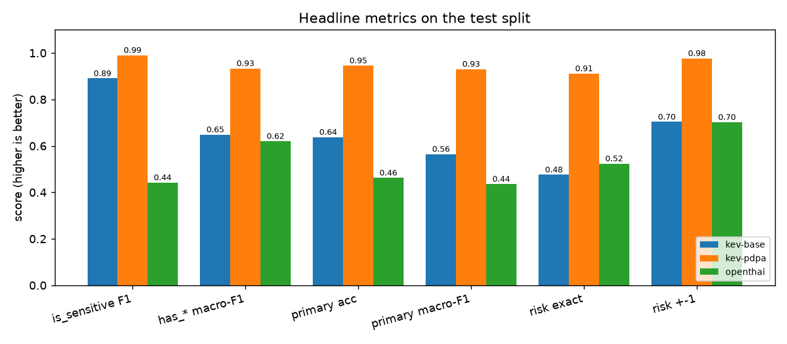

---
language:
  - th
  - en
license: apache-2.0
library_name: peft
base_model: jaredpalmer/kev-4b
base_model_relation: adapter
pipeline_tag: text-classification
tags:
  - pdpa
  - pii
  - privacy
  - thai
  - decision-model
  - calibration
  - lora
  - qlora
  - kev
  - typesafe
  - qwen3.5
datasets:
  - Datchthana/thai-pdpa-pii-synthetic
metrics:
  - accuracy
  - f1
  - brier_score
  - expected_calibration_error
model-index:
  - name: kev-thai-pdpa-guard
    results:
      - task: { type: text-classification, name: Thai PDPA sensitivity and risk (11 typed questions) }
        dataset: { type: Datchthana/thai-pdpa-pii-synthetic, name: thai-pdpa-pii-synthetic (test, 735 records), split: test }
        metrics:
          - { type: f1, value: 0.990, name: is_sensitive F1 }
          - { type: accuracy, value: 0.912, name: risk_level exact accuracy }
          - { type: accuracy, value: 0.946, name: primary_category accuracy }
          - { type: f1, value: 0.934, name: has_* macro-F1 }
          - { type: brier_score, value: 0.040, name: Brier (all questions) }
          - { type: expected_calibration_error, value: 0.011, name: ECE }
---

# kev-thai-pdpa-guard

**A Thai PDPA personal-data detector and risk scorer.** Give it a Thai (or Thai/English) text and it answers, in one
forward pass and without generating text, 11 typed questions: is the text sensitive, how risky is it on a 0–4 scale,
which personal-data category is the riskiest, and which of 8 data types appear, each with a calibrated probability.

A QLoRA fine-tune of [Kev-4B](https://huggingface.co/jaredpalmer/kev-4b) (a Jev-style System One decision model:
LoRA + pointer head on `Qwen/Qwen3.5-4B-Base`), trained on one **RTX 4060 Laptop (8 GB)**.

> **โมเดลตรวจข้อมูลส่วนบุคคลตาม PDPA ในข้อความภาษาไทย** บอกได้ว่าข้อความมีข้อมูลอ่อนไหวหรือไม่ เสี่ยงระดับใด (0–4)
> และมีข้อมูลประเภทใดบ้าง พร้อมความน่าจะเป็นที่ calibrate แล้ว · คู่มือภาษาไทยฉบับเต็มอยู่ใน
> [GitHub README](https://github.com/Datchthana1/kev-thai-pdpa-guard)

<!-- RESULTS:START -->
## Results

Locked **test split, 735 records** (templates and long-form texts by different authors than train/dev; never trained
on). All three systems received byte-identical states and questions (`input_sha` checked per record).

**What the metrics mean.** *Accuracy*: share of answers that are correct. *Precision* (is_sensitive): of the texts the
model flagged, how many really were sensitive (false alarms). *Recall*: of the truly sensitive texts, how many it caught
(misses; the critical number for privacy). *F1*: harmonic mean of precision and recall, high only when both are.
*Macro-F1*: F1 computed per category then averaged, so rare categories (credentials, s.26 data) count as much as
common ones. *Risk exact / ±1*: risk level exactly right / at most one level off. *MAE*: average number of levels the
risk prediction is off by. *Brier*: squared distance between the predicted probabilities and the truth (punishes
confident mistakes). *ECE*: calibration, i.e. whether answers given with 90% confidence are right ~90% of the time.
For all of these, higher is better except MAE, Brier, ECE and latency.

| Metric (test, n=735) | Kev-4B base (zero-shot) | **kev-thai-pdpa-guard** | OpenThai-SystemOne 0.8B |
|---|---|---|---|
| is_sensitive F1 | 0.890 | **0.990** | 0.442 |
| is_sensitive precision / recall | 0.876 / 0.905 | **0.993 / 0.988** | 0.968 / 0.287 |
| has_* macro-F1 (8 PII types) | 0.649 | **0.934** | 0.620 |
| primary_category accuracy / macro-F1 | 0.638 / 0.565 | **0.946 / 0.931** | 0.463 / 0.436 |
| risk_level exact accuracy | 0.476 | **0.912** | 0.524 |
| risk_level within ±1 | 0.703 | **0.977** | 0.702 |
| risk_level MAE | 1.033 | **0.125** | 1.083 |
| Brier (all questions, lower is better) | 0.247 | **0.040** | 0.295 |
| ECE (15 bins, lower is better) | 0.032 | **0.011** | 0.063 |
| Mean latency, RTX 4060 Laptop | 1.31 s (4-bit) | 1.28 s (4-bit) | **0.12 s** (bf16) |

Risk accuracy by gold level (n): 0 (313) 0.981 · 1 (55) 0.927 · 2 (60) 0.917 · 3 (87) 0.667 · 4 (220) 0.905
(base: 0.709 / 0.327 / 0.983 / 0.195 / 0.155). Hard negatives: risk exact accuracy 0.966 (base 0.503).

**Reading.** Fine-tuning lifts every metric; the largest gain is the 0–4 risk score (+43.6 pp), especially PDPA s.26
critical cases (0.155 → 0.905). OpenThai-SystemOne is ten times faster and reasonable on the per-type flags, but it is
zero-shot on this task and misses most sensitive texts (recall 0.287). The remaining weakness is risk 3: 23 of its 29
misses are under-predictions where the "three or more PII types → +1" escalation applies (e.g. name + phone + address).
The test split comes from the same synthetic generator family, so absolute numbers are optimistic for real-world
text; the system-to-system comparison on identical items is the reliable signal. Full tables:
[`results/comparison.md`](results/comparison.md).


<!-- RESULTS:END -->

## Model details

| | |
|---|---|
| Developer | Datchthana (built with a Claude agent team: Opus PM, Sonnet leads, Haiku developers) |
| Model type | Decision model: causal LM backbone run prefill-only + pointer head over the supplied options |
| Initialised from | `jaredpalmer/kev-4b` (adapter + head), backbone `Qwen/Qwen3.5-4B-Base` (frozen) |
| Adapter | LoRA r=16, α=32 on q/k/v/o, gate/up/down and the Gated DeltaNet projections (33.8M trainable params) |
| Quantisation (training & default serving) | bitsandbytes NF4 + double quant, bf16 compute; DeltaNet gates `in_proj_a/b` kept bf16 |
| Calibration | the temperature stored in `head.pt` (inherited from Kev-4B, applied at load) |
| Languages | Thai (primary), English |
| Context | trained with states ≤ 1,024 tokens |
| License | Apache-2.0 |

## Intended use

- Screening chat logs, tickets, forms, emails, JSON logs and documents for personal data before they are stored,
  shared, sent to a third-party LLM, or used for analytics.
- Routing by confidence: auto-redact or block when `p_sensitive` is high, queue the uncertain middle for a human.
- A building block for PDPA data-mapping/ROPA inventories.

**Out of scope:** legal advice or a final determination of PDPA compliance; fully automated decisions with legal
consequences without human review; locating the exact span of each PII item (the model classifies, it does not tag
spans; use the dataset's `pii_spans` to train a tagger); documents longer than ~1k tokens without chunking.

## How to use

```bash
git clone https://github.com/Datchthana1/kev-thai-pdpa-guard && cd kev-thai-pdpa-guard
bash scripts/setup_env.sh      # Python 3.13 venv, torch cu128, Kev, bitsandbytes, flash-linear-attention
```

```python
import sys; sys.path.insert(0, "src")
from pdpa_guard.guard import PDPAGuard

guard = PDPAGuard("Datchthana/kev-thai-pdpa-guard")          # 4-bit backbone, ~3-4 GB VRAM
r = guard.check("ผู้ป่วย นายวิชัย ศรีสุข เป็นเบาหวาน ต้องฉีดอินซูลินวันละ 2 ครั้ง โทร 089-123-4567")
print(r.is_sensitive, r.p_sensitive)      # True 0.99...
print(r.risk_level, r.risk_label)         # 4 critical
print(r.primary_category)                 # health
print(r.detected())                       # ['has_name', 'has_contact', 'has_health_or_special']
```

The 11 questions are fixed (`pdpa_guard.guard.canonical_questions`). Any TypeSafe-style client can also send its own
`choice` / `score` / `noul` questions through `PDPAGuard.raw()` or the Kev server (`python -m kev.serve --run <this repo>`).

### Output

| Field | Meaning |
|---|---|
| `is_sensitive`, `p_sensitive` | personal data of an identifiable person present (threshold 0.5) |
| `risk_level`, `risk_label`, `risk_score`, `risk_probs` | 0 none · 1 low · 2 medium · 3 high · 4 critical; `risk_score` = expected level |
| `primary_category`, `category_probs` | none, name, contact, address, other_identifier, national_id, financial, credential, health, special_category |
| `flags` | p(yes) for has_name, has_contact, has_address, has_national_id, has_financial, has_credential, has_health_or_special, has_other_identifier |

### Risk scale

| Level | Rule (computed from the PII present) |
|---|---|
| 0 | no personal data of an identifiable person (company info, public figures in news, anonymous statistics, masked values) |
| 1 | weak identifier only: a name alone, LINE ID, plate, DOB without name |
| 2 | contactable/locatable: phone, email or home address |
| 3 | government/financial identifier: national ID, passport, bank account, card number |
| 4 | PDPA s.26 data about an identifiable person, credentials, full card data (number + expiry/CVV), or national ID + financial data |

+1 (max 4) when ≥3 distinct PII types co-occur.

## Training data

[`Datchthana/thai-pdpa-pii-synthetic`](https://huggingface.co/datasets/Datchthana/thai-pdpa-pii-synthetic): 2,741 train /
450 dev / 735 test **synthetic** records in 15 genres; 56% positive, 25% hard negatives (checksum-failing 13-digit
numbers, Luhn-failing card numbers, public figures, company contacts, masked values, anonymous health statistics),
19% clean negatives; 506 free-form long texts. Labels are computed by code from the recorded PII spans. The test split
uses templates and long-form texts written by different authors from train/dev; 0 cross-split near-duplicates.

## Training procedure

| | |
|---|---|
| Recipe | `kev.train` (official Kev trainer) + QLoRA patch (`src/kev_qlora`), `--init_from jaredpalmer/kev-4b` |
| Epochs / steps | 1 epoch, 343 optimizer steps |
| Optimiser | AdamW, lr 2e-5, OneCycle (10% warm-up), weight decay 0.01 |
| Batch | 1 record × 8 accumulation (each record = 11 questions); `--shared_prefix 1`, `--length_sort 1` |
| Loss | cross-entropy over each question's options (Kev default) |
| Precision | NF4 backbone, bf16 autocast, fp32 LoRA/head masters, gradient checkpointing |
| Kernels | flash-linear-attention 0.5.2 + triton-windows 3.4 (≈10× faster than the torch fallback on Windows) |
| Hardware / time | Intel i5-12500H, 16 GB RAM, RTX 4060 Laptop 8 GB; peak VRAM 4.55 GB; ≈ 2 h 55 min |

Training loss (25-step means): 0.352 → 0.268 → 0.148 → 0.112 → 0.087 → 0.063 → … → ≈0.03–0.06 at the end.

## Limitations and risks

- **Synthetic training data.** Realistic but not real; OCR noise, very long documents, dialects and heavy slang are
  under-represented. Validate on a labelled sample of your own data and freeze thresholds there.
- The risk scale is this project's operationalisation of PDPA principles, not an official PDPC standard.
- The test set is drawn from the same generator family (different authors/templates), so absolute scores are an
  optimistic estimate of real-world accuracy; the comparison between systems on identical items is the reliable part.
- Thai-first; English coverage comes from code-switched text and 15% English instructions.
- Classification only; it does not return PII spans or redact text.

## Citation / acknowledgements

Built on [Kev](https://github.com/jaredpalmer/kev) (Jared Palmer, Apache-2.0) and
[Qwen3.5-4B-Base](https://huggingface.co/Qwen/Qwen3.5-4B-Base) (Apache-2.0); compared with
[iapp/OpenThai-SystemOne](https://huggingface.co/iapp/OpenThai-SystemOne). Architecture diagrams by
[archify](https://github.com/tt-a1i/archify).
