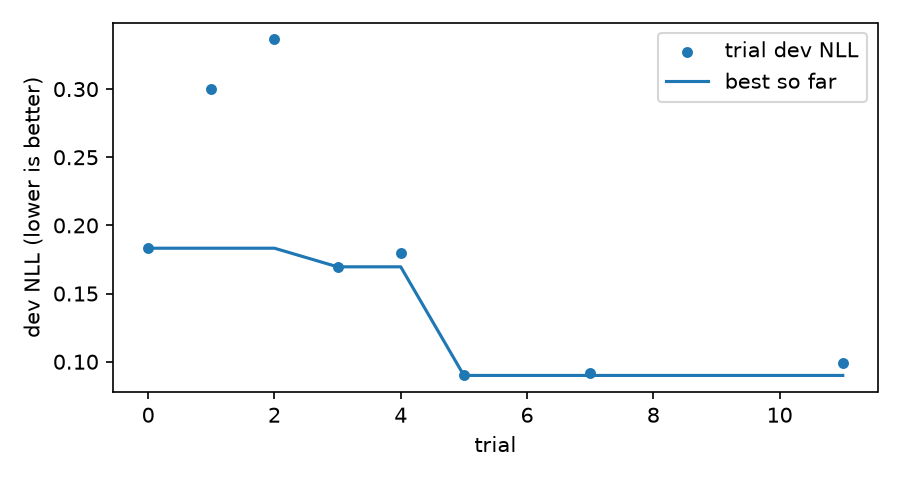

# kev-thai-pdpa-guard

**A model that checks whether Thai text contains personal data under the PDPA, and how risky it is**
Fine-tuned from [Kev-4B](https://huggingface.co/jaredpalmer/kev-4b) (a Jev-style decision model) with QLoRA 4-bit on a single laptop GPU (RTX 4060, 8 GB)

[](https://huggingface.co/Datchthana/kev-thai-pdpa-guard)
[](https://huggingface.co/datasets/Datchthana/thai-pdpa-pii-synthetic)


> ⚠️ **All data in this project is synthetic.** The names, ID numbers, card numbers and addresses are fake, and none of them belongs to a real person.
> The model is a screening aid, not a legal opinion. Final decisions under the PDPA must be reviewed by a person.

---

## Contents
1. [What this model does (in short)](#1-what-this-model-does-in-short)
2. [Quick start](#2-quick-start)
3. [The 11 questions the model answers](#3-the-11-questions-the-model-answers)
4. [Results and comparison](#4-results-and-comparison)
5. [System architecture](#5-system-architecture)
6. [Every function: what it does, input → output](#6-every-function-what-it-does-input--output)
7. [Workflows between functions](#7-workflows-between-functions)
8. [Dataset](#8-dataset)
9. [How we trained it](#9-how-we-trained-it)
10. [Limitations](#10-limitations)
11. [How the team worked (agent swarm)](#11-how-the-team-worked-agent-swarm)

---

## 1. What this model does (in short)

You give it **any text** (a chat message, an email, a form, a JSON log, a hospital note), and it answers in one go:

| Question | Example answer |
|---|---|
| Does it contain personal data? | `True` (probability 0.98) |
| How risky is it (0–4)? | `4 = critical` |
| Which category is the riskiest? | `health` (health data, PDPA section 26) |
| Which types of data appear? | `has_name`, `has_contact`, `has_health_or_special` |

What sets it apart from an ordinary LLM: **it doesn't generate text.** It reads the text once (a single forward pass) and returns a **probability** for each option, so there's no free-form answer to parse and nothing to hallucinate. You can set a threshold directly, e.g. "if p_sensitive > 0.9, block automatically; if 0.5–0.9, send to a person for review".

---

## 2. Quick start

### Install
```bash
git clone https://github.com/Datchthana1/kev-thai-pdpa-guard.git
cd kev-thai-pdpa-guard
bash scripts/setup_env.sh          # creates .venv (Python 3.13), installs torch cu128 + Kev + bitsandbytes
```
You need an NVIDIA GPU with ≥ 6 GB (it uses about 3–4.5 GB in 4-bit mode). Python 3.12–3.13.

### Use it from Python
```python
import sys; sys.path.insert(0, "src")
from pdpa_guard.guard import PDPAGuard

guard = PDPAGuard("Datchthana/kev-thai-pdpa-guard")   # downloads the adapter from HF and loads the 4-bit backbone
r = guard.check("รบกวนโอนคืนที่บัญชี กสิกรไทย 123-4-56789-0 ชื่อบัญชี สมชาย ใจดี โทร 081-234-5678 ค่ะ")

r.is_sensitive        # True
r.p_sensitive         # 0.99
r.risk_level          # 3
r.risk_label          # 'high'
r.primary_category    # 'financial'
r.detected()          # ['has_name', 'has_contact', 'has_financial']
r.to_dict()           # everything as a dict (including the probabilities of every option)
```

### Use it from the command line
```bash
PYTHONPATH=src python -m pdpa_guard.guard "ผู้ป่วย นายวิชัย ศรีสุข เป็นเบาหวาน ต้องฉีดอินซูลินวันละ 2 ครั้ง"
# sensitive : True (p=0.997)
# risk      : 4 critical / วิกฤต (expected 3.91)
# category  : health (0.962)
# detected  : has_name, has_health_or_special
```
Add `--json` to get JSON output, or `--model runs/pdpa-4b` to use a checkpoint you trained yourself.

---

## 3. The 11 questions the model answers

Every call asks the same 11 questions (defined in [`src/pdpa_guard/taxonomy.py`](src/pdpa_guard/taxonomy.py)):

| # | Question ID | Type | Meaning | Answer |
|---|---|---|---|---|
| 1 | `is_sensitive` | `noul` (yes/no) | Does it contain personal data of an identifiable person? | p(yes) |
| 2 | `risk_level` | `score` (0–4) | Risk level | Probability for each level + expected value |
| 3 | `primary_category` | `choice` (10 options) | The highest-risk category present | Probability for each option |
| 4 | `has_name` | `noul` | First/last name of a natural person | p(yes) |
| 5 | `has_contact` | `noul` | Personal phone number / email | p(yes) |
| 6 | `has_address` | `noul` | Home address | p(yes) |
| 7 | `has_national_id` | `noul` | National ID / passport number | p(yes) |
| 8 | `has_financial` | `noul` | Bank account / credit or debit card number | p(yes) |
| 9 | `has_credential` | `noul` | Password, OTP, PIN, API key | p(yes) |
| 10 | `has_health_or_special` | `noul` | Sensitive data under section 26 (health, religion, politics, criminal record, sexual orientation, ethnicity, biometrics) | p(yes) |
| 11 | `has_other_identifier` | `noul` | License plate, employee/student ID, IP, LINE ID | p(yes) |

### Risk levels (`risk_level`)

| Level | Name | Example | Rule |
|---|---|---|---|
| **0** | None | Company news, anonymous health statistics, a masked number `**** 1234` | No data about an identifiable person |
| **1** | Low | A name alone, a LINE ID alone, a license plate | Weak identifiers |
| **2** | Medium | Name + phone, or a home address | The person can be contacted or located |
| **3** | High | National ID number, passport, bank account, card number | Government or financial identifiers |
| **4** | Critical | A named person's illness, OTP/password, full card details with CVV, ID number + financial data | Section 26 data, credentials, or a combination usable for fraud |

> Escalation rule: if **3 or more distinct types** appear together, the level goes up by 1 (capped at 4), because combined data is riskier.
> Section 26 data that **can't be linked to anyone** (e.g. "51% of diabetes patients...") counts as 0.

---

## 4. Results and comparison

<!-- RESULTS:START -->
We compare **5 decision models** (System One / Jev-style: they read the text and return a probability for each option without generating text), **including the real Jev**, on the **test set of 735 records**. It was written by different authors from the training data and never seen during training. Every model received **identical text + questions** (verified with an `input_sha` hash on every record).

| Code name | Model | Size | Notes |
|---|---|---|---|
| **kev-base** | [`jaredpalmer/kev-4b`](https://huggingface.co/jaredpalmer/kev-4b) | 4B | Kev before fine-tuning (zero-shot) |
| **kev-pdpa** | **this model** `Datchthana/kev-thai-pdpa-guard` | 4B | Kev-4B + QLoRA on Thai PDPA data |
| **openthai** | [`iapp/OpenThai-SystemOne`](https://huggingface.co/iapp/OpenThai-SystemOne) | 0.8B | A Thai decision model from iApp (zero-shot) |
| **tev1** | [`togethercomputer/Tev1-4B-experimental`](https://huggingface.co/togethercomputer/Tev1-4B-experimental) | 4.3B | A 4B decision model from Together AI, the closest in size and type (zero-shot, Ollama `/v1/systemone`, Q8_0) |
| **jev** | **Jev (the original, by TypeSafe)** `typesafe-ai/jev` | not disclosed (hosted) | The original System One model that Kev reconstructs; called as an API through the Vercel AI Gateway (zero-shot, paid tier) |

> Only kev-pdpa was trained on PDPA data. The other 4 are zero-shot, so this comparison shows **how much domain fine-tuning adds** over general-purpose decision models, including the large hosted original.

### What each metric means (read this first)

Every metric below is computed by comparing **the model's answer** with **the correct answer** (computed by the rule code) on the 735 test records. There's a short example after each one, assuming a test set of 100 texts where 60 are truly sensitive and 40 are not.

| Metric | Plain-language meaning | Ideal value | Example |
|---|---|---|---|
| **Accuracy** | The fraction of answers that were correct | 1.0 (100%) | It answered 91 out of 100 questions correctly → accuracy 0.91 |
| **Precision** (is_sensitive) | Of the texts the model **flagged as sensitive**, how many really were. It measures **false alarms**. | 1.0 | It flagged 50 texts, 48 of which really were sensitive → precision 0.96 |
| **Recall** (is_sensitive) | Of the texts that **really were sensitive**, how many the model caught. It measures **misses**. For PDPA this matters most, because a miss means personal data leaks. | 1.0 | 60 were truly sensitive and it caught 48 → recall 0.80 |
| **F1** | A single number combining precision and recall. It's only high when **both** are good. | 1.0 | Precision 0.96 + recall 0.80 → F1 ≈ 0.87 |
| **Macro-F1** | Compute F1 for **each type/category separately**, then take the plain average. Rare categories count as much as common ones. | 1.0 | has_name F1 0.97 but has_credential F1 0.50 → the average gets pulled down |
| **risk exact accuracy** | The fraction of texts where the risk level **matched exactly** | 1.0 | True level 4, predicted 4 → correct. Predicted 3 → wrong. |
| **risk ±1 accuracy** | The fraction of predictions **at most one level off** | 1.0 | True level 4, predicted 3 → still counts |
| **MAE** of risk | **On average, how many levels off** the prediction is | 0 | Off by 0, 1, 0, 2 → MAE = 0.75 levels |
| **Brier score** | How far the **probabilities** are from the truth, squared; penalizes confident wrong answers heavily | 0 | True "yes": saying 0.95 → small penalty; saying 0.10 → big penalty |
| **ECE** | **Whether the model's confidence can be trusted.** When it says "90% sure", is it really ~90% correct? | 0 | Says 90% but is right only 70% of the time → large ECE |
| **Latency** | Time per text (local models on an RTX 4060 Laptop; Jev includes the network round trip to the API) | Lower is better | 1.28 s per text ≈ 47 texts per minute |

> **Why look at more than accuracy?** If 80% of texts aren't sensitive, a model that "always answers not sensitive" already scores 80% accuracy, yet catches nothing (recall = 0). So we also look at recall/F1, macro-F1 and Brier/ECE.

### Headline metrics (5 models)

| Metric | Kev-4B base | **kev-thai-pdpa-guard** | OpenThai-SystemOne | Tev1-4B | **Jev (original)** |
|---|---|---|---|---|---|
| is_sensitive F1 | 0.890 | **0.990** | 0.442 | 0.904 | 0.923 |
| is_sensitive precision / recall | 0.876 / 0.905 | **0.993** / 0.988 | 0.968 / 0.287 | 0.866 / 0.945 | 0.864 / **0.991** |
| has_* macro-F1 (8 types) | 0.649 | **0.934** | 0.620 | 0.671 | 0.764 |
| primary_category accuracy | 0.638 | **0.946** | 0.463 | 0.559 | 0.732 |
| primary_category macro-F1 | 0.565 | **0.931** | 0.436 | 0.520 | 0.736 |
| risk_level exact accuracy | 0.476 | **0.912** | 0.524 | 0.486 | 0.597 |
| risk_level ±1 accuracy | 0.703 | **0.977** | 0.702 | 0.702 | 0.797 |
| risk_level MAE (↓) | 1.033 | **0.125** | 1.083 | 0.913 | 0.735 |
| Brier, all questions (↓) | 0.247 | **0.040** | 0.295 | 0.253 | 0.197 |
| ECE, calibration (↓) | 0.032 | **0.011** | 0.063 | 0.039 | 0.023 |
| Latency per text (↓) | 1.31 s | 1.28 s | **0.12 s** | 3.27 s | 0.59 s (API) |


### What each row in the table measures

Each row measures **a different ability** of the model. Values are given as **Kev base / this model / OpenThai / Tev1-4B / Jev**.

#### 1. `is_sensitive F1`: 0.890 / **0.990** / 0.442 / 0.904 / 0.923
- **Measures:** whether the model can tell "**this text contains personal data**" from "**no, it doesn't**". It's the yes/no question that acts as the first gate.
- **Why F1:** this question has two kinds of mistakes: **missing** sensitive data (recall), where it leaks out unnoticed, and **false alarms** (precision). F1 is only high when both are rare.
- **Reading it:** Jev has the highest recall (0.991, it almost never misses), but it **false-alarms often** (precision 0.864, about 14% of its alerts are false). This model is good on both sides (0.993 / 0.988), so its F1 is higher. OpenThai misses about 71%.

#### 2. `risk_level exact accuracy`: 0.476 / **0.912** / 0.524 / 0.486 / 0.597
- **Measures:** whether the model rates the **risk level 0–4 exactly right** (0 none · 1 low · 2 medium · 3 high · 4 critical).
- **Why it matters:** this is what decides how strictly to handle the text. Level 4 should be blocked immediately; level 1 might just be logged.
- **Reading it:** even the real Jev gets only 59.7% (best among the zero-shot models). This model gets 91.2%, **31.5 points above Jev**, because Jev and the others don't know this project's PDPA risk rules (especially level 4 for section 26 data, where Jev scores 47.3%).

#### 3. `primary_category accuracy`: 0.638 / **0.946** / 0.463 / 0.559 / 0.732
- **Measures:** whether the model can say **which type of data in the text is the riskiest**, choosing 1 of 10 categories.
- **Example:** "นายสมชาย เป็นเบาหวาน โทร 081..." contains a name, a phone number and health data. The correct answer is **health** (section 26 data is the riskiest).
- **Reading it:** Jev comes second (73.2%); this model gets 94.6%.

#### 4. `has_* macro-F1`: 0.649 / **0.934** / 0.620 / 0.671 / 0.764
- **Measures:** whether the model can **detect every type of data that appears**: 8 yes/no questions (name, contact, address, national ID, financial, credential, health/section 26, other identifiers).
- **Why "macro":** F1 for each of the 8 types is averaged with equal weight, so a model that only handles common types can't look good overall.
- **Why it matters:** it's needed to decide **what to redact** and to build a data inventory (ROPA).

#### 5. `ECE (calibration)`: 0.032 / **0.011** / 0.063 / 0.039 / 0.023 (**lower is better**)
- **Measures:** **whether the model's confidence can be trusted.** If the model says "95% sure" 100 times, it should be right about 95 of those times.
- **Why it matters:** in practice you set thresholds on the probability (e.g. > 0.95 block automatically · 0.5–0.95 send to a person). If the confidence is unreliable, those thresholds don't work.
- **Reading it:** Jev's overall calibration is good (0.023, second place), but its ECE on the 0–4 risk-score question is high (0.282), so its risk probabilities can't be trusted. This model is off by about 1.1% overall and 4.3% on the risk score.

#### Summary

| Row | Question it answers | Best | Leader | This model vs the real Jev |
|---|---|---|---|---|
| is_sensitive F1 | Is this text sensitive? | 1.0 | **this model** | +0.067 |
| risk_level accuracy | How risky is it (0–4)? | 1.0 | **this model** | **+31.5 pp** |
| primary_category accuracy | What's the riskiest data type in it? | 1.0 | **this model** | +21.4 pp |
| has_* macro-F1 | Which data types does it contain (all 8)? | 1.0 | **this model** | +0.170 |
| ECE | Can its confidence be trusted? | **0** | **this model** | about 2× better |

### Accuracy per question

| Question | Kev base | **this model** | OpenThai | Tev1-4B | Jev |
|---|---|---|---|---|---|
| is_sensitive | 0.872 | **0.989** | 0.585 | 0.884 | 0.905 |
| risk_level | 0.476 | **0.912** | 0.524 | 0.486 | 0.597 |
| primary_category | 0.638 | **0.946** | 0.463 | 0.559 | 0.732 |
| has_name | 0.959 | **0.969** | 0.824 | 0.963 | 0.967 |
| has_contact | 0.927 | **0.992** | 0.917 | 0.950 | 0.940 |
| has_address | 0.941 | **0.996** | 0.944 | 0.944 | 0.988 |
| has_national_id | 0.966 | **0.997** | 0.946 | 0.973 | 0.978 |
| has_financial | 0.863 | **0.993** | 0.899 | 0.871 | 0.868 |
| has_credential | 0.811 | **0.992** | 0.898 | 0.906 | 0.977 |
| has_health_or_special (s.26) | 0.718 | **0.985** | 0.884 | 0.736 | 0.873 |
| has_other_identifier | 0.824 | **0.947** | 0.878 | 0.800 | 0.785 |

### Accuracy by true risk level

| True risk | n | Kev base | **this model** | OpenThai | Tev1-4B | Jev |
|---|---|---|---|---|---|---|
| 0 none | 313 | 0.709 | **0.981** | 0.840 | 0.668 | 0.712 |
| 1 low | 55 | 0.327 | **0.927** | 0.200 | 0.273 | 0.618 |
| 2 medium | 60 | 0.983 | 0.917 | 0.650 | **1.000** | 0.967 |
| 3 high | 87 | 0.195 | **0.667** | 0.034 | 0.195 | 0.230 |
| 4 critical | 220 | 0.155 | **0.905** | 0.314 | 0.255 | 0.473 |
| Hard negatives (look sensitive but aren't) | 177 | 0.503 | **0.966** | 0.746 | 0.480 | 0.503 |

### Calibration by question type (ECE, lower is better)

| Question type | Kev base | **this model** | OpenThai | Tev1-4B | Jev |
|---|---|---|---|---|---|
| yes/no (noul) | 0.041 | **0.006** | 0.030 | 0.019 | 0.024 |
| risk score 0–4 (score) | 0.121 | **0.043** | 0.230 | 0.319 | 0.282 |
| category (choice) | 0.044 | **0.036** | 0.193 | 0.231 | 0.132 |

### Reading the results
- **This model leads on every quality metric, including against the real Jev.** Jev is the strongest of the 4 zero-shot models (it ranks second on almost every row), which matches its published lead over Kev-4B on general tasks. But fine-tuning on Thai PDPA data puts this 4B model well ahead: +31.5 pp on risk_level, +21.4 pp on primary_category, +0.17 on has_* macro-F1.
- **Jev catches almost everything (recall 0.991) but false-alarms often (precision 0.864).** It's also easily fooled by hard negatives (0.503, the same as Kev base), e.g. order numbers that look like ID numbers, public figures in the news, or company contacts.
- **The 0–4 risk level is the biggest gap.** It's a rule specific to this project (PDPA section 26 → level 4, 3+ types → +1), which no zero-shot model can know. Jev gets level 4 right only 47.3% of the time; this model gets 90.5%.
- **Tev1-4B (same size)** tends to answer "2" for almost every risk level and is the slowest (3.3 s). **OpenThai** is the fastest (0.12 s) but misses most sensitive texts.
- **Remaining weak spot of this model:** risk 3 (0.667). Of the 29 misses, 23 were predicted **lower** (mostly as 2), almost all cases of the **"3 or more types → +1"** escalation rule. More training data for this rule, or computing the escalation in code after the model answers, would help. (Every other model is even weaker here: 0.03–0.23.)
- **Cost and speed:** Jev is a paid API (about $0.042 per million input tokens; this whole test cost only a few cents, but needs paid Vercel credits) and sends data out of your machine. This model runs **entirely locally** on an 8 GB laptop GPU, so personal data never leaves the machine, which itself matters for PDPA.
- ⚠️ The test set comes from the same data generator family (different authors and templates), so these absolute numbers are **an optimistic estimate** of real-world use. The part to trust is the **comparison between models on identical records**. Also, only this model was trained on the task; the other 4 are zero-shot.

### Jev on general tasks (published, for context)

The [Kev-4B card](https://huggingface.co/jaredpalmer/kev-4b) shows that on **general / English** tasks Jev is ahead of Kev-4B base (breadth-v1 test 0.757 vs 0.690; transfer-v4 dev 0.857 vs 0.817; MMLU-Pro 0.840 vs 0.565), while Kev-4B leads on the families it was trained for (hard-v1 0.786 vs 0.777, documents-v1 0.891 vs 0.868). Our result on the Thai PDPA task fits the same pattern: **a general model is strong on broad tasks, but domain fine-tuning beats it on the specific task.**

How to re-run the Jev comparison: put `AI_GATEWAY_API_KEY=vck_...` in `.env` (needs **paid** Vercel AI Gateway credits; Jev isn't available on the free tier), then
```bash
cd tools/jev_worker && npm install && cd ../..
python scripts/evaluate.py --system jev && python scripts/compare.py --systems kev-base,kev-pdpa,openthai,tev1,jev
```

More detail (by genre, confusion matrix, reliability diagrams): [`results/comparison.md`](results/comparison.md) · charts in `results/` (`bar_by_genre.png`, `risk_confusion_*.png`, `reliability_*.png`)
<!-- RESULTS:END -->

---

## 5. System architecture

The diagrams were made with the [archify](https://github.com/tt-a1i/archify) skill. Each one is an HTML file you can open in a browser (zoom, dark/light theme, export PNG/SVG):

| Diagram | File | What it shows |
|---|---|---|
| System architecture | [`docs/architecture/system-architecture.html`](docs/architecture/system-architecture.html) | The full picture: data pipeline → QLoRA training on the GPU → PDPAGuard → evaluation |
| Sequence of `check()` | [`docs/architecture/check-sequence.html`](docs/architecture/check-sequence.html) | Step by step, what happens inside one call |
| Dataset dataflow | [`docs/architecture/dataset-dataflow.html`](docs/architecture/dataset-dataflow.html) | How each record is built and where the labels come from |

Textual summary of the overall architecture:

```
┌────────────────────── Dataset pipeline (CPU) ───────────────────────┐
│ fakers.py ─┐                         taxonomy.py (PDPA rules)        │
│            ▼                                 ▼                       │
│ Templates ─► generate.py ──JSONL──► qa_dataset.py ──freeze──► Frozen  │
│   ▲            ▲                                              dataset │
│ Haiku writers  └── ingest_longform.py ◄── long-form texts            │
└──────────────────────────────────────────────────────────────┬───────┘
                                                               │ train split
HF Hub (kev-4b, Qwen3.5-4B) ──init_from──► train.py (QLoRA NF4) ◄┘
                                               │ save
                                               ▼
                 Your app ──check(text)──► PDPAGuard ◄──load 4-bit── runs/pdpa-4b
                                                                       │
            OpenThai-SystemOne ──► evaluate.py ◄── kev-base ◄── HF Hub  │
                                       │ ◄──────────── kev-pdpa ───────┘
                                       ▼
                                  compare.py → results/comparison.md + charts
```

---

## 6. Every function: what it does, input → output

### 6.1 `src/pdpa_guard/guard.py`: the main API (what most people will use)

| Function / class | Does | Input | Output |
|---|---|---|---|
| `PDPAGuard(model, device="cuda", load_4bit=True, threshold=0.5)` | Loads the model (Qwen3.5-4B 4-bit backbone + LoRA adapter + pointer head) | Hub id or a run folder | A ready-to-use object |
| `PDPAGuard.check(state, lang="th")` | Checks one text | `str`, or a dict/list (JSON) | `PDPAResult` |
| `PDPAGuard.check_many(states)` | Checks several texts | `list` | `list[PDPAResult]` |
| `PDPAGuard.raw(state)` | Lowest level: the raw probabilities of every question | text | `(answers: dict, seconds: float)` |
| `canonical_questions(lang)` | Builds the 11 questions in a fixed wording | `"th"` / `"en"` | dict of questions in the TypeSafe/Kev format |
| `PDPAResult.detected(threshold)` | Lists the `has_*` flags above the threshold | float | `list[str]` |
| `main()` | Command-line interface | argv | Prints the result |

Fields of **`PDPAResult`**: `is_sensitive`, `p_sensitive`, `risk_level` (0–4), `risk_score` (expected value, e.g. 3.4), `risk_label`, `risk_probs`, `primary_category`, `category_probs`, `flags` (8 probabilities), `latency_ms`

### 6.2 `src/pdpa_guard/taxonomy.py`: the PDPA rules (single source of truth)

| Function | Does | Input | Output |
|---|---|---|---|
| `effective_spans(spans)` | Drops section 26 data with no identifiable person | list of spans `{type, value}` | Filtered spans |
| `compute_risk(spans)` | Computes the risk level from the rules in section 3 | spans | `int` 0–4 |
| `primary_category(spans)` | Picks the highest-risk category | spans | `str` (one of 10 categories) |
| `has_flags(spans)` | Computes the 8 `has_*` flags | spans | `dict[str, bool]` |
| `build_questions(spans, rng, lang)` | Builds the 11 questions + labels (randomly choosing among ≥4 wordings per question) | spans, RNG | dict of questions with `label` |
| `labels_from_spans(spans)` | Labels only (used by QA/eval) | spans | `dict` |

### 6.3 `src/pdpa_guard/fakers.py`: realistic-looking fake data generators

| Function | Does | Output example |
|---|---|---|
| `make_thai_id(rng)` / `is_valid_thai_id(s)` | Generates/checks a 13-digit national ID with a **correct mod-11 checksum** | `3-1012-04567-89-2` |
| `make_invalid_id(rng)` | 13 digits that **fail** the checksum (used as hard negatives) | Order number `6903953791880` |
| `make_card(rng)` / `luhn_ok(s)` | Generates/checks a card number that **passes Luhn** with a real prefix (Visa 4, MC 51–55, JCB 35) | `4539 1488 0343 6467` |
| `s_name`, `s_phone`, `s_email`, `s_address`, `s_dob`, `s_passport`, `s_bank_account`, `s_card_full`, `s_password`, `s_otp`, `s_health`, `s_special`, `s_plate`, `s_ip`, `s_line_id`, … | Slot functions (48 slots) for each data type, in varied formats (dashes, spaces, Thai digits) | Thai names, real Thai provinces/districts/postcodes, Thai license plates |
| `s_order_no`, company/public-figure/masked-value slots | Data that **looks sensitive but isn't** | `TK-2026-4356`, `**** 7609` |

### 6.4 `src/pdpa_guard/generate.py`: assembling the dataset

| Function | Does |
|---|---|
| `load_templates(path)` | Reads the templates (`{name}`, `{phone}` … slots) |
| `instantiate(tpl, rng)` | Fills the slots with fake values and records `pii_spans` |
| `split_dev_templates(...)` | Sets aside a separate group of templates for dev (no leakage) |
| `make_split(...)` | Generates records for each split, controlling class balance and duplicates |
| `main()` | Writes `data/processed/{train,dev,test}.jsonl` (with meta) and `data/processed/kev/*.jsonl` (Kev training format) |

### 6.5 `src/kev_qlora/`: QLoRA patch + evaluation tools

| File / function | Does | Input → Output |
|---|---|---|
| `qlora.bnb_config()` | Config for 4-bit NF4 + double quant + bf16 compute | → `BitsAndBytesConfig` |
| `qlora.load_quantized_backbone(...)` | Loads Qwen3.5-4B as 4-bit straight onto the GPU | model name → backbone |
| `qlora.prepare_kbit(lm)` | Freezes the base, enables gradient checkpointing, keeps embeddings in bf16 (saves 2.5 GB compared with peft's default) | backbone → ready to train |
| `qlora.make_class()` | Builds `QLoRADecisionModel`, a subclass of Kev's `DecisionModel` that supports 4-bit | → class |
| `qlora.install()` | Patches `kev.train` to use the 4-bit model (the original Kev code isn't modified) | → holder |
| `qlora.load_adapter_inference(run, device)` | Loads adapter + head + calibration temperature for inference | run dir → `(tokenizer, model)` |
| `systems.KevSystem.predict(state, questions)` | Runs a Kev model on one request | → `(answers, seconds)` |
| `systems.get_system(name)` | Selects a system: `kev-base`, `kev-pdpa`, `openthai` | → system |
| `openthai_adapter.OpenThaiSystem` | Runs `iapp/OpenThai-SystemOne` via transformers or Ollama with the same questions | → `(answers, seconds)` |
| `metrics_pdpa.compute_metrics(rows)` | Computes accuracy, P/R/F1, macro-F1, risk MAE, Brier, ECE, latency | prediction rows → dict of metrics |
| `compat.*` | Shims for `resource`/`fcntl`, which don't exist on Windows | — |

### 6.6 `scripts/`: commands to run

| Script | Does | Main output |
|---|---|---|
| `make_value_packs.py` | Generates PII "value packs" for the long-form writers | `data/longform/packs_*.jsonl` |
| `ingest_longform.py` | Checks that every PII value appears verbatim in the text, and drops records that don't | `data/longform/N_A.jsonl`, `N_B.jsonl` |
| `validate_templates.py` / `merge_templates.py` | Validates/merges the templates | `data/templates/*.jsonl` |
| `qa_dataset.py` | **Quality gate**: recomputes the labels, checksums, Luhn, duplicates, template leakage (exits non-zero on any error) | `QA_REPORT.md` |
| `train.py` | QLoRA training (wraps `kev.train`), logs step/loss/VRAM | `runs/pdpa-4b/` |
| `evaluate.py` | Runs one system on the test set (resumable) | `results/eval_<system>.json` |
| `compare.py` | Builds the comparison table + charts | `results/comparison.md`, `*.png` |
| `run_pipeline.sh` | train → eval of 3 systems → compare, in one go | everything above |
| `tune_optuna.py` | Hyperparameter search with Optuna (TPE + MedianPruner), **minimizing dev NLL** (not train loss, to avoid overfitting); resumable | `results/optuna/best_params.json`, `trials.md`, `optuna_history.png` |

---

## 7. Workflows between functions

### 7.1 When you call `guard.check(text)` (inference)
See the diagram [`check-sequence.html`](docs/architecture/check-sequence.html)

1. **`PDPAGuard.check`** receives the text → calls **`canonical_questions("th")`** to get the 11 questions
2. Passes them to **`KevSystem.predict(state, questions)`**
3. `predict` → **`kev.api.to_record()`** validates the request format and converts JSON into labelled text
4. → **`DecisionModel.encode` + prefill**: the Qwen3.5-4B (4-bit) + LoRA backbone reads the text **once**, and each of the 11 questions is a "row" that reuses the cache of that text
5. → the **pointer head** turns the hidden states into logits per option → divides by the temperature T → softmax = **calibrated probabilities**
6. `check` packages the result as a **`PDPAResult`** (picks the level/category with the highest probability, computes the expected risk value)

**Data passed between functions:**
`str` → `{11 questions}` → `record (state text + option keys)` → `token ids` → `hidden states [rows × 2560]` → `probs per option` → `PDPAResult`

### 7.2 Building the dataset (data pipeline)
See [`dataset-dataflow.html`](docs/architecture/dataset-dataflow.html)

```
Template path:   templates + fakers.s_*() ──► generate.instantiate() ──► pii_spans
Long-form path:  fakers ──► make_value_packs ──► Haiku writes text around the values ──► ingest_longform (verbatim check)
Both paths:      pii_spans ──► taxonomy.build_questions() (labels computed by code) ──► qa_dataset.py ──► FROZEN
```
**The key point:** labels are always computed by `taxonomy.py` from `pii_spans`. No person or model ever "picks a label" itself, so the labels are consistent across the whole dataset.

### 7.3 Training → evaluation
```
data/processed/kev/train.jsonl ──► scripts/train.py ──(qlora.install patches kev.train)──► runs/pdpa-4b/
runs/pdpa-4b ─┐
kev-4b base  ─┼──► scripts/evaluate.py (identical state + questions for every system; input_sha checks this) ──► results/eval_*.json
OpenThai     ─┘                                                                  └──► scripts/compare.py ──► comparison.md
```

---

## 8. Dataset

Published at [`Datchthana/thai-pdpa-pii-synthetic`](https://huggingface.co/datasets/Datchthana/thai-pdpa-pii-synthetic)

| Split | Records | Positive | Hard negatives | Clean negatives | Long-form texts |
|---|---|---|---|---|---|
| train | 2,741 | 55.9% | 25.1% | 19.0% | 341 |
| dev | 450 | 56.2% | 25.3% | 18.4% | 50 |
| test | 735 | 57.4% | 24.1% | 18.5% | 115 |

**Quality was prioritized over quantity:**
- **15 genres**: LINE chat, support ticket, shipping form, job application, hospital note, bank/loan, school records, government form, social post, email, server log/JSON, rental contract, insurance claim, news, product review
- **Every value is valid**: national IDs pass the mod-11 checksum, card numbers pass Luhn, provinces/districts/postcodes are real
- **Hard negatives that look sensitive but aren't**: 13-digit order numbers that fail the checksum, card numbers that fail Luhn, public figures in the news, company addresses/phone numbers (juristic persons aren't covered by the PDPA), masked data, anonymous health statistics
- **506 natural long-form texts** (300–1,200 characters) written by 11 Haiku writers, with every PII value checked to appear verbatim
- **No leakage**: test uses B templates written by **different authors** from the A templates used for train/dev; there are 0 near-duplicates across splits (5-gram Jaccard ≥ 0.8)
- Mixed Thai/English instructions (15% English), with at least 4 wordings per question so the model doesn't memorize one phrasing

Risk distribution in test: 0 = 313 · 1 = 55 · 2 = 60 · 3 = 87 · 4 = 220 (the full report is in [`data/processed/QA_REPORT.md`](data/processed/QA_REPORT.md))

---

## 9. How we trained it

| Item | Value |
|---|---|
| Starting model | `jaredpalmer/kev-4b` (LoRA r16 + pointer head on `Qwen/Qwen3.5-4B-Base`) via `--init_from` |
| Quantization | NF4 4-bit + double quant, bf16 compute (bitsandbytes); the DeltaNet gates `in_proj_a/b` stay bf16 |
| LoRA | rank 16, α 32; targets q/k/v/o, gate/up/down, and the Gated DeltaNet projections (same as Kev); 33.8M trainable params |
| Optimizer | AdamW, lr 2e-5 one-cycle, weight decay 0.01 |
| Batch | 1 × accumulation 8; `--shared_prefix 1` (each text runs once, questions share its cache); `--length_sort 1` |
| Epochs | 1 (343 optimizer steps) |
| max_state | 1,024 tokens |
| Kernels | flash-linear-attention 0.5.2 + triton-windows 3.4: about **10× faster** than the torch fallback |
| Hardware | i5-12500H, 16 GB RAM, **RTX 4060 Laptop 8 GB** (peak VRAM ≈ 4.5 GB) |
| Time | ≈ 3 hours |

### Hyperparameter search (Optuna)

We used [`scripts/tune_optuna.py`](scripts/tune_optuna.py) to look for the settings that give the **lowest dev loss (NLL)**. Train loss isn't used, because the lowest train loss comes from memorizing the training data (overfitting).
- Sampler: TPE (seed 1) + MedianPruner (stops trials worse than the median early)
- Each trial: 40 steps on a fixed subset of 1,200 train records, scored on 150 dev records
- Trial 0 = the current recipe (the v1 model) as a baseline

| trial | Status | dev NLL ↓ | lr | accum | regularizer | ord_w |
|---|---|---|---|---|---|---|
| 0 (v1 recipe) | complete | 0.183 | 2.0e-5 | 8 | none | 0.00 |
| 3 | complete | 0.170 | 6.9e-5 | 4 | none | 0.17 |
| **5 (best)** | complete | **0.090** | **9.3e-5** | **16** | none | **0.98** |
| 7 | complete | 0.092 | 8.1e-5 | 16 | none | 0.65 |
| 11 | complete | 0.099 | 6.7e-5 | 16 | none | 0.61 |
| 1, 2 | complete | 0.300, 0.337 | ~1e-5 | 4 | label smoothing ~0.11 | |
| 6, 8, 9, 10 | pruned | | | | | |

**What we learned:** (1) a higher learning rate (7e-5 to 9e-5) works better than 2e-5 · (2) label smoothing and the Brier loss **hurt** (dev NLL roughly doubled) · (3) `ord_w` (an ordinal loss on the 0–4 risk score) helps, which should directly address the risk 3 weakness · (4) ⚠️ the accum 16 trials saw 4× more data in the same 40 steps, so part of their win comes from extra data, not just better settings.

Status: the full retrain with the best params (v2) was **stopped to prioritize comparing against other models**. The published model is still **v1**. To run it: `bash scripts/overnight.sh` (Optuna → retrain → eval) or use the flags in `results/optuna/best_params.json`. Full table: [`results/optuna/trials.md`](results/optuna/trials.md)



Reproduce:
```bash
bash scripts/setup_env.sh
# the dataset lives on HF (not in git, because GitHub push protection blocks the fake API keys in the credential examples)
hf download Datchthana/thai-pdpa-pii-synthetic --repo-type dataset --local-dir data/processed
bash scripts/run_pipeline.sh            # train + eval + compare
```
> To regenerate the data from scratch: `python src/pdpa_guard/generate.py` (needs `data/longform/` from the long-form step) then `python scripts/qa_dataset.py`

---

## 10. Limitations

- **The data is synthetic.** It's realistic but not real-world data. Real-world texts (scanned documents, OCR, heavy slang) may score lower.
- The data is mainly Thai; English shows up only in mixed text and in 15% of instructions.
- Some long-form records have a condition that doesn't match the person (e.g. a disease specific to one sex) because the values come from random value packs. The labels are still correct.
- The test set has few `name` records as the primary category (14).
- `risk_level` follows the rules **this project defined** from PDPA principles. It isn't an official standard from the regulator (PDPC).
- The model reads only the first 1,024 tokens it was trained on. For longer documents, split them into chunks first.
- Don't use it as the sole basis for decisions with legal consequences. Send uncertain cases (p between 0.3 and 0.9) to a person for review.

---

## 11. How the team worked (agent swarm)

This project was built by a team of AI agents arranged like a project team:

| Role | Model | Count | Responsibility |
|---|---|---|---|
| Senior Project Manager | Claude **Opus** | 1 | Spec (`docs/SPEC.md`), review/quality gates, GPU scheduling, QLoRA training + optimization (fla kernels), architecture diagrams, README/Model Card, release |
| Assistant PM: data-lead | Claude **Sonnet** | 1 | Designed the taxonomy, generator, QA; supervised the Haiku devs; 2 rounds of fixes following PM review |
| Assistant PM: train-lead | Claude **Sonnet** | 1 | Environment, QLoRA patch, train wrapper, eval harness, verified metrics independently |
| Developers | Claude **Haiku** | 27 | Data round 1 (9): fakers.py, templates A1–A4 / B1–B3 (different authors for train/test). Data round 2 (16): 3 filler rewirers, A5/B4 templates, 11 long-form writers (8 for train/dev, 3 for test). Train/eval (2): evaluate/compare/metrics, OpenThai adapter |

Quality gates that were enforced: the PM rejected the first data round (unrealistic filler values, too few section-26 test records, texts too short) → round 2 added 506 long-form records and rebalanced the test set → the data was frozen with sha256 before training.

---

## License and acknowledgements
- Adapter, head, code and dataset: **Apache-2.0**
- Base model: [Qwen/Qwen3.5-4B-Base](https://huggingface.co/Qwen/Qwen3.5-4B-Base) (Apache-2.0); [Kev](https://github.com/jaredpalmer/kev) by Jared Palmer (Apache-2.0)
- Compared against [iapp/OpenThai-SystemOne](https://huggingface.co/iapp/OpenThai-SystemOne) (Apache-2.0) and [togethercomputer/Tev1-4B-experimental](https://huggingface.co/togethercomputer/Tev1-4B-experimental), and the hosted TypeSafe Jev (`typesafe-ai/jev`) via the Vercel AI Gateway
- Diagrams by [archify](https://github.com/tt-a1i/archify) (MIT)
